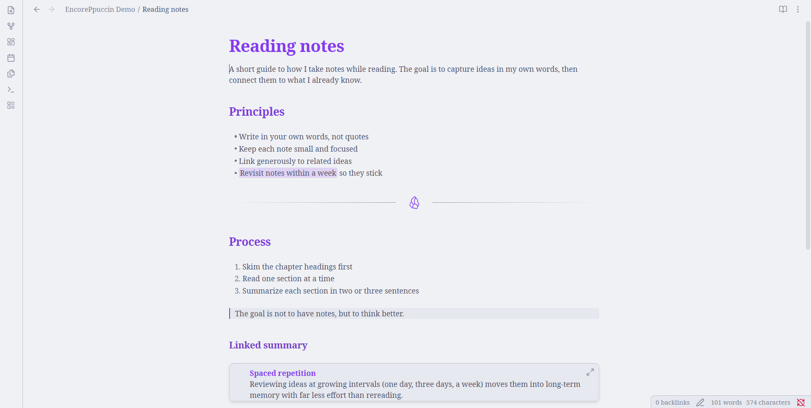
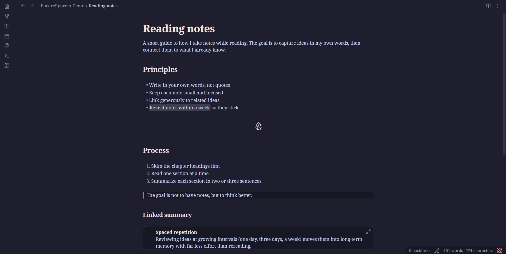

# EncorePpuccin

An Obsidian theme that takes [FastPpuccin](https://github.com/LostViking09/obsidian-fastppuccin), a fast build of [AnuPpuccin](https://github.com/AnubisNekhet/AnuPpuccin), and adds a few UI components from [Encore](https://github.com/Carbonateb/obsidian-encore-theme).

## What's different from FastPpuccin

FastPpuccin's CSS is included unchanged, so its colour schemes, accents and Style Settings options still work. On top of it, EncorePpuccin adds these components from Encore, recoloured to use FastPpuccin's palette:

- **Divider:** `---` renders as a line with the Obsidian logo in the middle, in your accent colour.
- **Sidebar tabs:** the sidebar tab icons become a segmented pill switcher.
- **Highlights:** `==highlighted==` text gets a soft tint of your accent colour.
- **Embedded notes:** `![[embeds]]` show as raised cards.
- **Headings:** Encore's larger, heavier heading scale.
- **Empty tab:** an empty tab shows the Obsidian wireframe logo.
- **Heading colours:** H1 uses your accent colour (Obsidian's purple by default), and each lower level blends further towards the body text colour. Change the accent and the headings follow. To set your own colours, install Style Settings, open the **EncorePpuccin** section, and pick a colour for each level in light and dark mode. Turn on **Turn off custom heading colours** to go back to FastPpuccin's.

Everything else, including tabs, the status bar, the command palette, blockquotes and tooltips, looks the same as in FastPpuccin.

## Installation

1. Copy `theme.css` and `manifest.json` into `<your vault>/.obsidian/themes/EncorePpuccin/`.
2. In Obsidian, go to **Settings → Appearance → Themes** and choose **EncorePpuccin**.

To pick a flavour (Latte, Frappé, Macchiato, Mocha) or accent colour, install the [Style Settings](https://github.com/mgmeyers/obsidian-style-settings) plugin. Without it, the theme uses Latte in light mode and Mocha in dark mode.

## Credits

- **[AnuPpuccin](https://github.com/AnubisNekhet/AnuPpuccin)** by AnubisNekhet: the original theme almost all of this code comes from. If you'd like to support it, [buy AnubisNekhet a coffee](https://www.buymeacoffee.com/anubisnekhet).
- **[FastPpuccin](https://github.com/LostViking09/obsidian-fastppuccin)** by LostViking09: the high-performance AnuPpuccin clone this theme is built on. [Support LostViking09](https://www.buymeacoffee.com/lostviking09).
- **[Encore](https://github.com/Carbonateb/obsidian-encore-theme)** by Carbonateb (Lucas Champagne): the divider, sidebar switcher, highlight, embed, heading and empty-tab styles.
- **[Blue Topaz](https://github.com/PKM-er/Blue-Topaz_Obsidian-css)** by PKM-er: FastPpuccin's table hover effect.
- **[Catppuccin](https://github.com/catppuccin/catppuccin):** the colour palette.

## License

EncorePpuccin is licensed under the [GNU General Public License v3.0](LICENSE), as are FastPpuccin and AnuPpuccin. The parts adapted from Encore are used under the MIT License, and their copyright notice is kept in `theme.css`.

Changes from FastPpuccin (2026-10-20): added the Encore-derived section at the end of `theme.css`, described above. FastPpuccin's own code is unmodified.
